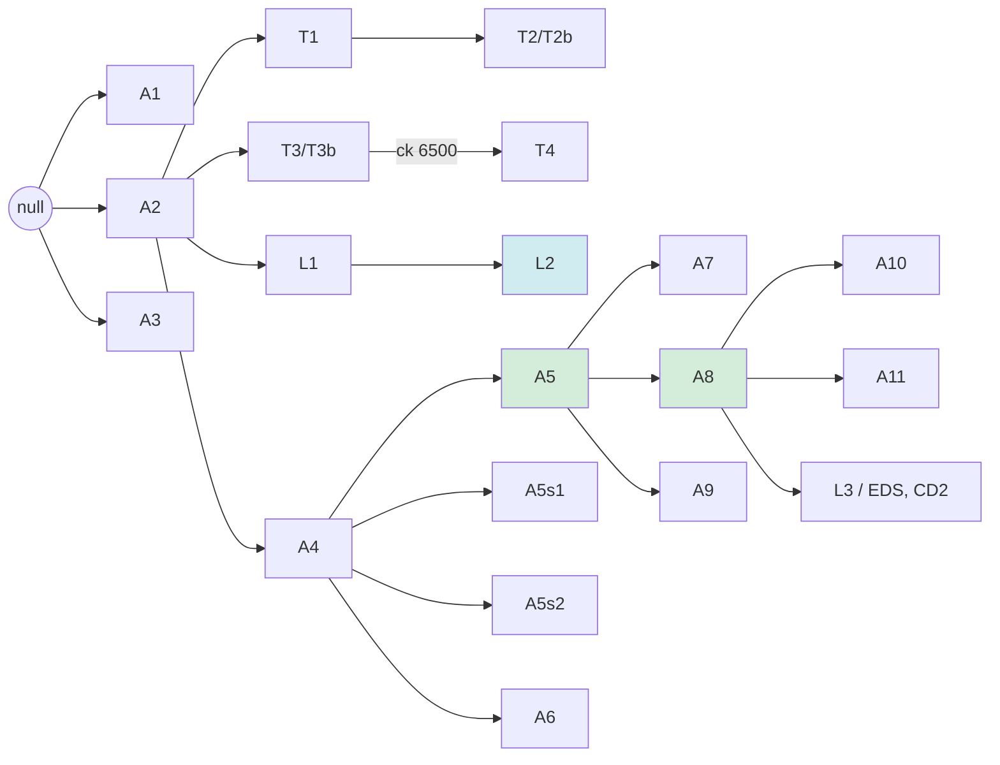

# Experimente: welche Läufe, warum, mit welchem Ergebnis

Dieses Dokument ist das Laborbuch in verdichteter Form. Zu jedem Lauf steht:

- die **Frage** oder Hypothese
- die **Änderung** gegenüber dem Vorgänger, möglichst genau eine Variable
- der **Start** (ab null oder ab welchem Checkpoint)
- das **Ergebnis** und die **Schlussfolgerung**

Die vollständigen Einträge mit Job-IDs, Logs und Videos stehen in der Notion-Datenbank „Experimente“ (Teamspace RobotChallenge). Die Parameter selbst stehen in [PARAMETER.md](PARAMETER.md).

## Methodik und Kennzahlen

| Kennzahl | Definition | Quelle im Log |
| --- | --- | --- |
| Sturzrate | Anteil beendeter Episoden mit `bad_orientation` oder `base_height` | `Episode_Termination/*` |
| Geschw.-Fehler [m/s] | mittlerer Betrag ‖v_xy − v_cmd‖ | `Metrics/base_velocity/error_vel_xy` |
| Dreh-Fehler [rad/s] | mittlerer Betrag \|ω_z − ω_cmd\| | `Metrics/base_velocity/error_vel_yaw` |
| Gelände-Stufe | mittlere Curriculum-Stufe (0–9) | `Curriculum/terrain_levels` |
| Episodenlänge | Mittel, max. 1000 | `Mean episode length` |

**Mittelung:**
- **Trainingswerte:** Mittel der letzten 100 Iterationen (Meilenstein 18./19.11.) oder letzte Iteration (ab 20.11.), jeweils über 4096 Umgebungen.
- **Robustheitstest:** Mittel der letzten 30 von 60 Iterationen ohne Policy-Update.
- **MuJoCo (Sim-to-Sim):** fester 30-s-Ablauf mit Befehlsfolge vorwärts 0,5/1,0, seitlich 0,3, rückwärts 0,4, Kurve, Drehen 0,8 rad/s und zwei seitlichen Stößen. Gemessen wird die tatsächlich erreichte Geschwindigkeit.

**Grenzen der Vergleichbarkeit:**
1. Trainingswerte entstehen unter dem Curriculum. Zwei Läufe sind nur vergleichbar, wenn beide auf der Maximalstufe von Befehlen und DR enden. Bei Gelände-Läufen muss zusätzlich die Gelände-Stufe gleich sein.
2. Der Reward ist nur innerhalb gleicher Reward-Gewichte vergleichbar.
3. Bis auf A5 (drei Seeds) gibt es je Konfiguration nur einen Seed. Unterschiede unter ~0,5 % Sturzrate oder ~0,05 m/s Fehler sind deshalb nicht als belastbar zu werten.
4. MuJoCo-Ergebnisse sind Einzelabläufe, also eine Stichprobe von 1.

## Stammbaum der Checkpoints

Grün sind die Kandidaten für den echten Roboter, blau ist die Vorlage für den Schüler (CD2). A7b und A7c sind Ablationen zu A7 und im Bild nicht eingezeichnet.

---

## Phase 0: Infrastruktur und Baseline (10.–17.11.)

| Lauf | Frage | Ergebnis | Schluss |
| --- | --- | --- | --- |
| Setup | Läuft Isaac Sim 5.1 / Isaac Lab 2.3.2 offline im Container auf dem Cluster? | Ja (Smoke-Test, 2 Iterationen) | Infrastruktur steht |
| Baseline 1000 It. (29 DoF) | Wie weit kommt Unitrees Standard-Task? | 97,7 % Stürze, Befehl 0,1 m/s | zu kurz trainiert |
| **Baseline 3000 It. (29 DoF)** | dto., länger | 28,4 % Stürze, Reward 24,9 (steigt noch), Befehl bleibt bei 0,3 m/s | Unitrees Befehls-Curriculum (Schwelle 80 %) bremst. Referenz für alles Weitere |
| Lauf A „CD1 Treppen + DR“ | Lernt die Policy Treppen, wenn Gelände, DR und Befehle sofort voll schwer sind? | 59 % Stürze, Gelände-Stufe 0,05, im Video nur Wackeln | **Einstieg zu schwer.** Daraus folgen adaptive Curricula und Weitertrainieren ab Baseline |

## Phase 1: Meilenstein 18./19.11. (29 DoF, adaptive Curricula)

Alle Läufe starten ab Baseline 3000. Die Auswertung kam per automatischer Slurm-Kette über Nacht.

| Lauf | Änderung | Stürze | Gelände | Geschw.-Fehler | Ergebnis |
| --- | --- | --- | --- | --- | --- |
| B1 | Treppen, Curricula V1 | 14 % | 1,5 | 0,73 | fertig |
| B2 | B1 + Tracking-Gewicht 2,0 | 39 % | 3,6 | 0,38 | NaN-Absturz bei It. 4362 |
| B3 | eben, adaptive DR | 1 % | – | 0,41 | fertig |
| B4 | Treppen, **Curricula V2** | 24 % | 2,3 | 0,59 | fertig |
| B5 | B4 + Tracking-Gewicht 2,0 | 38 % | 3,1 | 0,37 | NaN-Absturz |

**Erkenntnisse:**
- V1 steigert DR und Befehle zu früh, weil Stürze oft spät in der Episode kommen und die Episodenlänge deshalb ein zu gutmütiges Kriterium ist. **V2** steuert über die Sturzrate und funktioniert.
- Tracking-Gewicht 2,0 behebt das „Treten auf der Stelle“ (Geschw.-Fehler halbiert) und bringt die Policy höher ins Gelände.

## Phase 2: Umstellung auf 23 DoF (18./19.11.)

Der Betreuer hat am 17.11. darauf hingewiesen, dass in der Challenge der 23-DoF-G1 eingesetzt wird. Alle 23-DoF-Läufe verwenden Curricula V2.

| Lauf | Start | Änderung | Stürze | Geschw.-Fehler | Gelände | Ergebnis |
| --- | --- | --- | --- | --- | --- | --- |
| A1 | null | eben, Unitree-Rewards | 0,7 % | 0,38 | – | fertig, DR und Befehle auf Maximum |
| **A2** | null | A1 + Tracking 2,0 | 0,2 %¹ | 0,33 | – | **bester ebener Lauf, Basis aller weiteren** |
| A3 | null | Treppen + Tracking 2,0 | 35 % | 0,42 | 2,7 | NaN-Absturz nach 1879 It. |

¹ Mittel der letzten 100 Iterationen. Die Notion-Seite von A2 nennt 0,4 % für die letzte Iteration.

Training dauert ~1,5 h pro 4000 Iterationen auf einer H200. V100-Knoten laufen mit dem Container nicht.

## Phase 3: Blinde Treppen und die NaN-Abstürze (19.11.)

| Lauf | Start | Änderung | Ergebnis |
| --- | --- | --- | --- |
| T1 | A2 | Treppen, Tracking 1,0 | NaN-Absturz nach ~450 It. Bester Zwischenstand It. 4200: Stufe 2,3, 6 % Stürze |
| T2 / T2b | A2 | wie T1, T2b mit `base_height_l2_safe` | T2: NaN ab It. 5040. T2b intakt bis It. 7670 (13,5 % Stürze, Stufe 4,9, Geschw.-Fehler 0,63), dann Value Loss → ∞ |
| T3 / T3b | A2 | B5-Rezept (Tracking 2,0) | T3: NaN ab It. 4377. **T3b** intakt bis It. 6582 (15,1 % Stürze, Stufe 5,6, Geschw.-Fehler 0,55), bester blinder Treppenlauf |

**Ursachenanalyse der Abstürze**, vier Läufe mit identischem Fehler `normal expects all elements of std >= 0.0`:

1. **Erste Hypothese** (19.11. abends): Tracking-Gewicht 2,0 + Treppen ist instabil. **Widerlegt** durch T1, das mit Gewicht 1,0 genauso abstürzte.
2. **Zweite Hypothese:** Gelände-Curriculum zu schnell + wachsende Policy-Std (bei T1 0,45 → 0,60). Diese Hypothese passt zum Verlauf, war aber nicht die Ursache des Absturzes.
3. **Befund** (Diagnose 19.11.): Strahlen des Höhenscanners ohne Treffer liefern `inf`. Der relative `base_height`-Reward wird dadurch `−inf`, und der Gradient macht die Std zu `NaN`. **Fix:** `base_height_l2_safe`. Danach blieben noch seltene, endliche Ausreißer (T2b/T3b, Value Loss → ∞). **Zweiter Fix:** Reward-/Beobachtungsschutz und Std-Begrenzung, siehe PARAMETER.md, Abschnitt 11. Seit dem 20.11. ist kein Lauf mehr abgestürzt.

**Inhaltlicher Befund (bleibt gültig):** Eine blinde Policy „stolpert“ Treppen hinunter, weil sie die Kante nicht sehen kann. Das Curriculum schiebt sie auf Stufen bis 18 cm. Dort fällt sie häufig, wird vorsichtiger und verliert andere Fähigkeiten (T4, A10).

## Phase 4: Sim-to-Sim und Robustheit für den echten Roboter (19.–20.11.)

| Lauf | Start | Hypothese / Änderung | Isaac | MuJoCo | Schluss |
| --- | --- | --- | --- | --- | --- |
| Sim-to-Sim A2 | – | Überträgt A2 nach MuJoCo (`g1_23dof_rev_1_0.xml`)? | – | 27 s ohne Sturz; vor 0,5 → 0,52, 1,0 → 1,02; seitl. 0,3 → 0,26; rückw. 0,4 → 0,33; Drehen 0,2 → **0,04** | überträgt, aber **dreht nicht**. Armature 0,01 im MJCF nötig |
| Checkpoint-Vergleich A2 | – | Überangepasst an Isaac? | – | MuJoCo wird bis ~3000 It. besser, dann konstant | keine Überanpassung. Die Drehschwäche ist eine Trainingslücke (A2 kannte nur ±0,2 rad/s) |
| A4 | A2 | Latenz 0–20 ms, Motorstärke ±10 %, Drehbefehle bis ±1,0 | 0,4 % Stürze | kein Sturz; Drehen 0,8 → **0,06** | robust, aber Drehen nicht gelernt: Curriculum hängt bei ±0,5. Ursache ist das Gewichtsverhältnis Drehen 0,5 zu Geschwindigkeit 2,0 |
| **A5** | A4 | Dreh-Gewicht 0,5 → **1,5**, Aufstiegsschwelle 50 → 40 % | **0,1 %**, Dreh-Fehler 0,83, Geschw.-Fehler 0,29 | kein Sturz; vor 1,0 → 1,05; Drehen 0,8 → **0,71**; Kurve 0,2 → 0,17; Stöße abgefangen | **Kandidat für den echten Roboter** |
| A6 | A4 | A5 + Gangbild (gait 1,5, Fußhöhe 2,0, Schleifen −0,5, Armschwung, air time) | 0,6 %, Dreh-Fehler 1,54 | Drehen 0,8 → 0,50; vor 1,0 → 0,93 | Gangbild-Reward steigt (1,58 statt 0,51), kostet aber Drehen und Tempo |
| T4 | T3b ck6500 | blinde Treppen + A4/A5-Robustheit + Drehen | 25,6 % Stürze, Drehen hängt bei ±0,2 | – | blind + Treppen + Latenz + Drehen ist zu viel |
| L1 (Lehrer) | A2 | T3-Rezept + **exaktes Höhenraster** für Policy und Critic | **0,4 %** Stürze bei Stufe 5,2, Geschw.-Fehler 0,37 | – | blinde Läufe auf gleicher Stufe: 13–15 % Stürze. **Wahrnehmung ist der entscheidende Faktor auf Treppen** |
| L2 (Lehrer robust) | L1 | L1 + Latenz, Motorstärke, Drehen | 0,7 %, Stufe 4,4, Dreh-Fehler 1,06 | – | Vorlage für den Schüler (CD2) |

## Phase 5: Robustheitstest, Reproduzierbarkeit, Ablationen (22.–24.11.)

### Robustheitstest (keine Policy-Updates, 4096 Roboter)

Sturzraten:

| Szenario | A5 | A5s2 | **A8** | A9 |
| --- | --- | --- | --- | --- |
| E0 nominal | 0,3 % | 0,2 % | **0,05 %** | 0,06 % |
| E1 glatt (μ 0,15–0,3) | 44 % | 55 % | **39 %** | 47 % |
| E2 Stöße 1,5 m/s alle 2–4 s | 7 % | 7,3 % | **2,7 %** | 6,8 % |
| E3 Latenz 30–40 ms | 0,5 % | 0,4 % | **0,2 %** | |
| E4 Last +4–6 kg | 0,2 % | 0,5 % | **0,1 %** | |
| E5 Motor 70–80 % | 0,4 % | 0,7 % | **0,15 %** | |
| E6 kombiniert | 21 % | 23 % | **10 %** | 14 % |

A5 hält deutlich mehr aus als trainiert: Latenz bis 40 ms, +6 kg, 70 % Motorstärke. **Einzige klare Schwäche: Reibung unter 0,3.** In MuJoCo stürzt A5 in keinem Szenario (Reibung 0,3, +5 kg, Latenz 30/40 ms, Stöße 1,0/1,5 m/s, kombiniert).

### Trainingsläufe dieser Phase

| Lauf | Start | Frage / Änderung | Ergebnis | Schluss |
| --- | --- | --- | --- | --- |
| A5s1b, A5s2 | A4 | **Reproduzierbarkeit:** A5-Rezept mit Seed 1 und 2 | 0,3 % / 0,3 %, Dreh-Fehler 0,83 / 0,84; MuJoCo Drehen 0,78 / 0,80 | **A5-Rezept reproduzierbar**, kein Glückstreffer |
| A7 | A5 | Links/Rechts-Symmetrie (Daten-Augmentierung) + Gangbild moderat | Dreh-Fehler **2,13**; MuJoCo Drehen 0,05 | dreht nicht mehr |
| A7b | – | Ablation: nur Symmetrie | Dreh-Fehler 1,69; MuJoCo Drehen 0,11 | **die Symmetrie verhindert das Drehen** |
| A7c | – | Ablation: nur Gangbild | Dreh-Fehler 1,04; MuJoCo Drehen 0,55 | Gangbild kostet etwas (wie A6) |
| **A8** | A5 | unebener Boden (Rauheit ≤ 6 cm, Rampen ≤ 0,3 rad, Kanten ≤ 5 cm) | 0,6 %, Stufe 4,2, Dreh-Fehler 0,91; MuJoCo-Treppe 5 cm ganz überquert | **in jedem Testszenario robuster als A5** |
| A9 | A5 | glatter Boden: μ 0,15–1,25 | 0,67 %, Dreh-Fehler 0,86; E1 47 % | **Ziel verfehlt:** μ < 0,3 kommt bei Gleichverteilung nur in ~13 % der Fälle vor |
| A10 | A8 | A8 + blinde Treppen-Mischung | **21 %** Stürze, Dreh-Fehler 2,25; MuJoCo-Treppe 5 cm: Sturz | gescheitert (wie T4). Blind sind > ~10 cm nicht sinnvoll lernbar |
| A11 | A8 | A8 + μ 0,1–0,9 | 1,45 %, Dreh-Fehler 1,05; MuJoCo kein Sturz, Drehen 0,72 | Robustheitstest E0–E6 läuft (Stand 24.11.) |

**Zu A7/A7b:** Die Spiegelfunktion wurde geprüft und ist formal korrekt: Gelenk-Permutation und Vorzeichen, Drehrate (−x, y, −z), Befehl (vx, −vy, −ωz), Historien-Aufbau. Die wahrscheinliche Ursache ist der `gait`-Reward. Er hängt an einer festen Uhr (linker Fuß zuerst), die die Policy nicht beobachtet und die beim Spiegeln nicht mitgespiegelt wird. Die gespiegelten Daten widersprechen damit dem Reward. Für CD1 wird die Symmetrie nicht weiter verfolgt.

### MuJoCo-Treppe (6 Stufen hoch, Podest, 5 runter)

| Modell | 5 cm | 8 cm | 10 cm |
| --- | --- | --- | --- |
| A8 | kein Sturz (9,2 m) | Sturz nach 6 s | – |
| T3b ck6500 | kein Sturz (8,1 m) | Sturz nach 0,5 m | – |
| A10 | Sturz nach 4,4 m | Sturz nach 3,4 m | Sturz nach 1,9 m |

## Phase 6: CD2 Wahrnehmung (ab 23.11., läuft)

Das Vorgehen folgt der Vorlesung RL_v2: Policy (Höhenkarte + Propriozeption → Aktionen) und EDS (Kamera/LiDAR/IMU → Höhenkarte) werden getrennt trainiert, beide im 165-Punkte-Raster.

- **L3:** Lehrer ab A8 mit einer EDS-artigen, gestörten Höhenkarte in der Policy und der exakten Karte im Critic.
- **EDS:** Datensatz und Autoencoder/Decoder für Tiefe, LiDAR und Fusion.

Ergebnisse folgen.

---

## Stand der Empfehlung (24.11.)

1. **Realtest-Hauptkandidat: A8.** In allen Robustheitsszenarien am besten, dreht ausreichend (MuJoCo 0,73 rad/s bei 0,8 befohlen), überquert 5-cm-Stufen.
2. **Vergleich/Rückfall: A5** (bzw. A5s2, dreht in MuJoCo genauer).
3. **Nicht auf glattem Boden testen** (μ < 0,3: poliert, nass). Teppich oder Gummimatte verwenden.
4. **Treppen über 5 cm nur mit Wahrnehmung** (Lehrer/Schüler, CD2). Keine weiteren blinden Treppenläufe.
5. Nicht verwenden: A7/A7b/A7c (Drehen), T4 und A10 (Sturzrate), A9 (Ziel verfehlt).

## Offene Punkte

- Robustheitstest A11 auswerten. Wenn E1 deutlich unter 39 % liegt, A11 als Kandidat für glatten Boden aufnehmen.
- ONNX-gegen-TorchScript-Vergleich der Deploy-Pakete (im Container fehlt `onnxruntime`).
- Mehr Seeds für A8 (bisher nur einer).
- Gleichverteilung der Reibung ersetzen, z. B. 30 % der Roboter fest auf μ < 0,3, statt nur den Bereich zu erweitern (Lehre aus A9).
- Raster der Höhenkarte (L3/EDS) mit dem Betreuer abgleichen.
